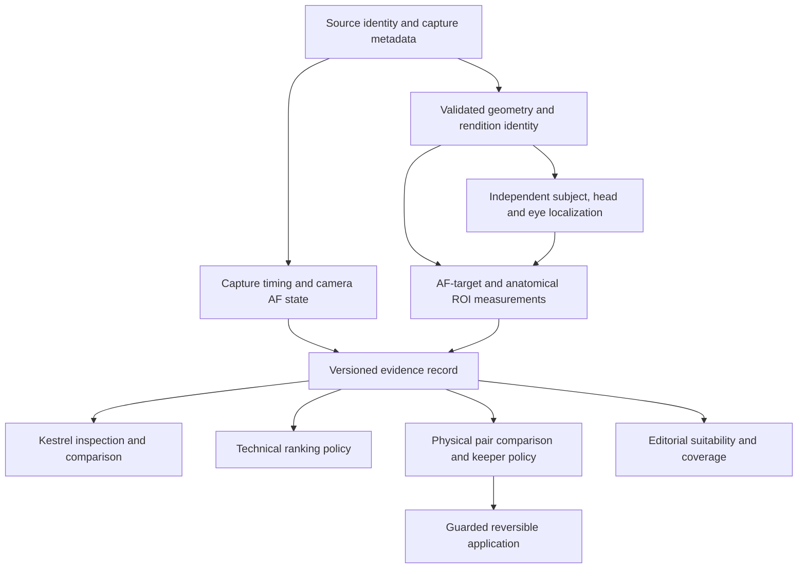

# Focus evidence synergy and enhancements

The useful shared asset is reproducible **evidence about a subject**, rather than a single shared score.
Capture metadata describes the camera's AF state; pixels establish local detail; temporal context helps
interpret changes. Technical ranking, duplicate suppression and editorial selection consume those facts
under different policies. This is a proposal, not implemented behavior or permission to activate a policy.

This expands the user's Nikon focus triage note using the actual `DSC_0056.NEF`–`DSC_0066.NEF` files,
the two supplied screenshots, the current sibling checkouts and the [Kestrel review](../reports/architecture-review-2026-10-23/kestrel-as-built.md).
The [campaign report](../reports/architecture-review-2026-10-23/INDEX.md) separates retained fixes from experiments and gaps.
The original Downloads note and photographs remain unchanged.

## What the evidence changes

1. All eleven Z8 files report `AFInfo2Version=0400`, coordinates available, successful focus and the
   same distance, approximately 6.712 m. Focus success and distance have **no discriminating power in
   this sample**. They are not independent votes for an eye being sharp.
2. The AF grid is 8256×5504. RAW dimensions include an 8280×5520 grid; `CropArea` reports
   `12 8 8256 5504`. Treating every coordinate as a fraction of the RAW dimensions can misplace an
   overlay. The route to the particular embedded preview still needs calibration.
3. The 2363×1487 areas in 0060–0061 cover about 7.73% of the AF grid. The 304×304 and 326×326
   areas cover about 0.203% and 0.234%. A larger area supplies less precise localization evidence;
   it does not establish missed focus. Its camera-mode semantics remain an interpretation to verify.
4. The capture times produce four groups with a 500 ms adjacent-gap rule: **0056–0057,
   0058–0059, 0060–0061, 0062–0066**. Gaps separating them are 9.60 s, 3.35 s and 0.57 s.
   Consecutive filenames do not establish continuous tracking. User-edited burst membership remains
   authoritative for the review workflow, while temporal feature eligibility is checked independently.
5. Exposure changes across groups: f/8 to f/6.3, ISO and shutter differences. Noise and processing can
   change gradient measurements. Compare matched pixel preparation and report these covariates.
6. Kestrel currently estimates bird eye detail from the subject's strongest gradients. Its loaded pose
   adapter targets mammal eyes. An AF-to-eye feature needs a verified bird eye location, not this estimate.

ExifTool's public [Nikon decoder](https://raw.githubusercontent.com/exiftool/exiftool/master/lib/Image/ExifTool/Nikon.pm)
distinguishes versioned AF layouts and conditional coordinate fields. Use the installed decoder's actual
output and retain its version; do not implement offsets copied from a speculative wiki report.
The installed ExifTool 13.52 extraction was read-only; all eleven source hashes matched before and after.
Detailed local extraction lives in the ignored campaign scratch directory; the
[reduced receipt](../reports/architecture-review-2026-10-23/evidence/nikon-focus-summary.json) contains no image pixels or absolute library path.

## Architecture and ownership

| Owner | Contribution | Consumer boundary |
|---|---|---|
| Pipeline | Batched metadata adapter, decode/rendition identity, selected-region ownership, evidence persistence | AF evidence is a distinct source; it does not replace the user's selected subject |
| Eye model | Anatomical localization, local measurements, separate visibility and confidence | AF-target detail is not relabeled as eye quality; generic or mammal landmarks do not certify bird eyes |
| Skills | Pair evidence, physical-equivalence checks, local dominance, representative coverage, editorial explanations | AF proximity never proves two frames redundant; editorial fit stays separate |
| Kestrel | Local inspection, synchronized comparison, explicit missing-evidence display, stored-evidence reweighting | Preserve manual flags, overrides, pins and burst locks |
| Hub and LLM Wiki | Integration contract, experiment freezes, source-bound findings and decisions | Candidate knowledge is visibly distinguished from reviewed requirements |

This plan proposes future functionality. Kestrel runtime and approved specifications remain unchanged.

## Proposed evidence contract

Names below describe proposed fields, not existing public APIs. Extend through existing provider and
storage boundaries after reviewing the owning repository's migration contract.

| Evidence | Required contents | Missing or invalid behavior |
|---|---|---|
| Source | Source digest, camera/lens identity, capture time with original subsecond precision, metadata decoder/version | Unknown time disables temporal comparisons; file mismatch invalidates derived evidence |
| Camera AF | Group-qualified raw tags, AF layout/version, mode, coordinate availability, original dimensions/rectangle, focus result/distance and units | Unsupported/missing values are unknown; never substitute zero or a failed-focus label |
| Geometry | Source coordinate frame, crop/orientation/resize transform chain, rendition dimensions/digest, decoder and preprocessing identity | Unverified mapping disables alignment features and overlay assertions |
| Anatomy | Subject identity, selected-region identity, head/eye points or boxes, visibility, localization confidence, provider/weights | AF-target measurements remain usable under their own name even when anatomy is unavailable |
| Pixels | ROI identity/role, native crop dimensions, analysis scale, gradient/noise/exposure features, preprocessing recipe | Low resolution, clipping and missing texture are explicit applicability limits |
| Temporal | Body identity, capture-group identity, adjacent time gap, matched subject identity, eligible neighbors | No carry across a gap, body switch or unresolved subject association |
| Decision | Evidence digest, consumer/policy version, result, reason codes, protections and uncertainty | Stale evidence causes recomputation or abstention, never silent reuse |

Keep `ExifIFD:ISO` and `Nikon:ISO` separate: they differ in these files. Keep raw subsecond strings such
as `08`; converting to the integer 8 before interpreting the decimal fraction changes timing.
Store raw and interpreted values separately. Do not parse a flattened tag dictionary that silently wins
on duplicate names. Reject non-finite numbers and booleans at every numerical decision boundary.

Geometry must explicitly say whether `(x,y)` is a pixel center, an edge or a rectangle center. For a
validated center-based AF rectangle, form its four corners, transform all corners, then derive bounds
in the destination. An AF point `(x,y)` maps to `(x+12,y+8)` only when targeting the uncropped RAW
grid in the observed sample; an active-area preview must not receive that offset a second time.
Do not assume an embedded preview is a full-resolution RAW development.

Record separate applicability facts for camera decoding, geometry compatibility, anatomy localization
and pixel measurement. They are not interchangeable calibrated probabilities. A metadata agreement
score must not inflate the landmark detector's confidence or multiply local sharpness by confidence.

## Features worth testing

**Start with explainable geometry.** Report AF area as a fraction of its own grid; eye containment;
distance from eye point to AF rectangle (zero inside); and distance to its center. Normalize anatomical
distances by a valid head scale. A center-distance penalty alone incorrectly penalizes large valid
regions. When only a point is localized, rectangle/eye-box IoU is undefined and must remain absent.
Measure each visible eye separately and state which subject/eye the evidence concerns.

**Measure the pixels independently.** Obtain comparable head/eye crops and an AF-target crop. Compare
multiscale detail and noise, inspect clipping/catchlights, and preserve the decode recipe. Treat AF-target
detail as target detail. A sharp beak or textured background does not establish eye sharpness. A local
eye-to-head detail ratio is an experimental feature with an explicit low-texture failure mode, not a
universal normalized score. Native-crop measurement should complement the inexpensive overview scan.

**Use temporal residuals rather than raw camera coordinates.** After subject association, compare AF
position relative to head/eye position and scale, conditioning on elapsed time and pose change. Camera
panning moves both coordinates; raw AF movement alone is not tracking failure. Abrupt AF-area size
changes request inspection. Temporal smoothing must not erase a single good frame in an otherwise soft burst.

**Use disagreement to schedule work.** A camera reports focus while measured eye detail is poor;
AF lies outside a confidently located head; or a broad AF region makes eye alignment uninformative.
These cases merit native crops or user review. A metadata-aligned but visibly blurred frame stays poor;
a sharp eye with unavailable/misaligned AF metadata is not automatically downgraded.

The Downloads note's illustrative 55/20/15/10 fusion is not adopted. No coefficient is justified by these
eleven frames. Start with diagnostics and compute scheduling; test ranking changes only after frozen
blind labels exist. AF state alone must not trigger automatic rejection or duplicate suppression.

## Delivery sequence and acceptance criteria

| Stage | Concrete deliverable and owner | Acceptance evidence | Decision at this review |
|---|---|---|---|
| 0 — Contract and geometry | Pipeline metadata adapter proposal; Kestrel requirements; versioned coordinate/rendition fixtures | All 8 EXIF orientations; active-area vs RAW/preview grids; crop modes; partial AF tags; version mismatch; namespace collisions; finite-value boundaries; source hashes unchanged | Proceed with specification and tests; Z8 v0400 observed, Z6 II layout not certified |
| 1 — Inspection | AF rectangle/center and separately identified eye/head overlays; side-by-side native crops; reasons and unavailable states | Independently marked landmarks align on real NEFs within a predeclared annotation tolerance; overlays and caches invalidate on source/transform changes; no review flags or scores change | Highest-value first implementation after each repo's contract gate |
| 2 — Local evidence | Eye-model/provider crop evidence plus AF-target detail; cheap overview followed by selective higher-resolution decode | Frozen full-frame/selected-region ablation; noise/texture/visibility subgroups; decoded-pixel identity; latency, peak memory and coverage denominators | Pilot required; bird eye applicability is a blocker for AF-to-eye claims |
| 3 — Shadow ranking | Consumer-specific versioned policy with baseline, pixels-only, metadata-only diagnostic and combined variants | Capture-group/folder-separated human-blind evaluation; paired grouped uncertainty; unchanged protections; reasons for abstention; reproducible settings replay | No production adoption from current evidence |
| 4 — Conservative culling | Skills physical-equivalence uncertainty and local keeper dominance; Kestrel review suggestion only | Every suppression has a direct retained keeper; protected frames and rare-view coverage retained; order independence; stale-artifact rejection; dry-run/apply/revert parity | AF used as context or abstention cue; no equivalence shortcut |
| 5 — Consolidation | Canonical docs, evidence-bound wiki candidates and adoption/rejection receipts | Exact source/weight/input hashes, policy versions, labels and test results; unknown checks remain visible | Promote knowledge through normal review; rollout remains a separate gated task |

Acceptance tolerances, acceptable quality tradeoffs and policy coefficients must be frozen before the
relevant comparison. They remain open requirements, not values an agent should infer from this sample.
If stage 1's geometry is inconclusive, stop alignment experiments and retain metadata-only inspection.

## Evaluation and compute budget

Use the eleven NEFs as an **engineering conformance pilot**, not a natural-image accuracy benchmark.
They come from one camera/lens/session and provide only four temporal groups. Add already permitted
captures covering alternate orientations/crops, AF modes, subject sizes, occlusion, low light and another
supported camera/version before making compatibility claims. Do not acquire or export new data implicitly.

Freeze capture-group/folder splits before annotation. Gather human judgments on matched image/crop
views without AF overlays first; record any later metadata-informed judgments separately. Preserve
human labels, judge-derived labels, historical approvals and synthetic fixtures as distinct sources.
Neither Kestrel's lead nor a historical pipeline rank is ground truth. Obtain dataset permission and
valid annotations before training; this plan does not authorize training from screenshots or inferred labels.

For ranking report pairwise preference/keeper regret and the fraction with valid eye evidence; for culling
report false suppression, distinct-view retention and candidate/measurement/decision coverage separately.
Include subgroup denominators and grouped confidence intervals. Report median/tail latency, decode count,
peak memory, abstention rate and failure reasons. Stable point estimates with wide intervals remain inconclusive.

Stay within the campaign ceiling: baseline/conformance 2 GPU-hours; eye/localization 6; region/scoring 6;
deduplication 8; final held-out replay 2. **GPU used so far: 0 hours.** CPU replay already found useful
questions without consuming that allocation. Run one GPU workload at a time, at most two hours per run,
freeze code/inputs/weights/preprocessing/parameters/stopping conditions, and count failures against the cap.
Unused allocation is not a reason to run another experiment. Final held-out access keeps its existing gate.

The current development replay did not establish a production winner: eye confidence filtering changed
4/16 synthetic selections; continuous normalization left the sampled rankings unchanged; omitting ARNIQA
had uncertain development effects; stricter dedupe uncertainty reduced proposed suppressions from 26 to 3
without establishing a false-cull rate. These are hypotheses for the staged comparisons, not adoption evidence.

## Wiki context and authority

The lookup found a **candidate** Nikon claim `777d6a2a-a2da-456c-a06a-2ec660b6ba0f`
(source revision `586d5075-2662-4d2e-97a2-9e6f817ac53b`) and a **stale** parsing claim
`9b707658-aa2c-4199-977b-7b2ea453396f` (source revision
`1e9627d2-4fac-4d10-a56a-947b8178e46a`). The candidate report itself acknowledges that its example
layouts lacked actual sample verification. Neither status supplies reviewed implementation authority.
The new extraction establishes facts only about these eleven Z8 files and ExifTool 13.52.

The earlier [synergy report](../reports/model-pipeline-skills-synergy-2026-10-23.md) remains a dated
nested-checkout baseline. Use the newer sibling revisions in the campaign report for current code facts;
do not silently replace historical claims.
